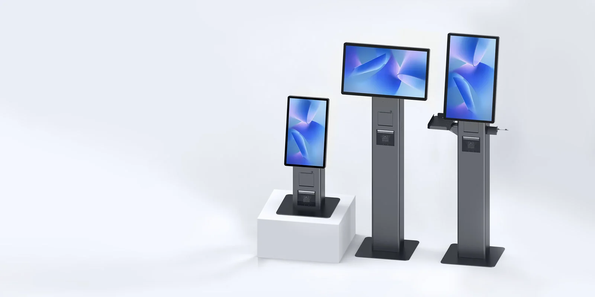
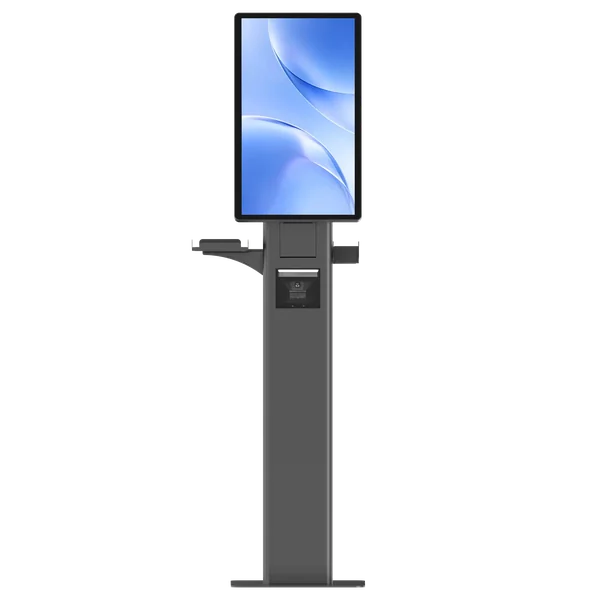
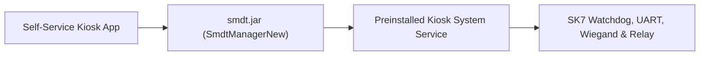

<div align="center">
  <a href="https://www.suntekai.com">
    <picture>
      <source media="(prefers-color-scheme: dark)" srcset="https://raw.githubusercontent.com/SUNTEK-Official/.github/main/profile/assets/logo-dark.png">
      <source media="(prefers-color-scheme: light)" srcset="https://raw.githubusercontent.com/SUNTEK-Official/.github/main/profile/assets/logo-light.png">
      
    </picture>
  </a>

  <h1>SUNTEK SK7 Kiosk Android System & IO SDK</h1>

  <p>
    <strong>Official Hardware SDK &amp; Developer Kit</strong> &middot; <em>Enjoy Smarter Service</em><br>
    Official Android kiosk system, watchdog, Wiegand, relay, and serial UART control SDK (<code>sdk/smdt.jar</code> / <code>SmdtManagerNew</code>) for <strong>SK7</strong> self-service kiosks by <strong>SUNTEK Technology Co., Ltd.</strong>
  </p>

  <p>
    <a href="./LICENSE"></a>
    <a href="https://github.com/SUNTEK-Official/suntek-sdk-sk7/releases"></a>
    
    <a href="https://www.suntekai.com/products/suntek-self-service-kiosk-sk7/"></a>
    <a href="mailto:support@suntekai.com"></a>
  </p>

  <p>
    <a href="#hardware-showcase--compatibility">Hardware</a> &nbsp;&bull;&nbsp;
    <a href="#architecture--key-capabilities">Architecture</a> &nbsp;&bull;&nbsp;
    <a href="#supported-interfaces--physical-connections">Interfaces</a> &nbsp;&bull;&nbsp;
    <a href="#5-minute-quick-start">Quick Start</a> &nbsp;&bull;&nbsp;
    <a href="#sample-apps--prebuilt-downloads">Downloads</a> &nbsp;&bull;&nbsp;
    <a href="#troubleshooting--faq">FAQ</a> &nbsp;&bull;&nbsp;
    <a href="#documentation-changelog--support">Support</a>
  </p>
  
</div>

---

## Hardware Showcase & Compatibility

<table>
  <tr>
    <td align="center" width="38%">
      <a href="https://www.suntekai.com/products/suntek-self-service-kiosk-sk7/">
        
      </a>
      <br>
      <strong>SK7</strong><br>
      <sub>Modular Self-Service Kiosk</sub><br>
      <a href="https://www.suntekai.com/products/suntek-self-service-kiosk-sk7/">Official Product Page</a>
    </td>
    <td valign="top" width="62%">
      <ul>
        <li><strong>Modular Mounting</strong>: Supports desktop, floor-standing, and portrait/landscape installations</li>
        <li><strong>Unattended Watchdog</strong>: Hardware watchdog feeding and scheduled RTC power on/off</li>
        <li><strong>Rich Peripherals</strong>: RS-232/TTL UART, Wiegand card reader, GPIO &amp; gate relay APIs</li>
        <li><strong>Full Sample App</strong>: Complete <code>SmdtApiDemo</code> project bundled with real <code>smdt.jar</code></li>
      </ul>
    </td>
  </tr>
</table>

| Product Model | Chipset / Board | OS Versions | Build Identifier | Status |
| :--- | :--- | :--- | :--- | :---: |
| **SK7** | Embedded ARM Platform | Android 11 - 14 | `SK7*` | Supported |

> [!IMPORTANT]
> Verify your device **Model** and **Build Number** under Android **Settings -> About device** before integration. Customer applications use your own Google Play or enterprise release certificate.

---

## Architecture & Key Capabilities

- **Built for Unattended Kiosks**: Hardware watchdog timer, scheduled RTC power cycling, and immersive UI bar control.
- **Peripheral Bus Access**: Unified Java control across serial UART ports, Wiegand interfaces, and relay switches.
- **Out-of-the-Box Working SDK**: Bundles the production `smdt.jar` (`android.app.smdt.SmdtManagerNew`) and complete Android Studio sample project.



---

## Supported Interfaces & Physical Connections

| Hardware Feature | Interface Type | Device Path / Service Target | Notes |
| :--- | :--- | :--- | :--- |
| **SK7 System SDK JAR** | Java API (`android.app.smdt.SmdtManagerNew`) | `sdk/smdt.jar` | Watchdog, UART, GPIO, Wiegand, display & power control |
| **Watchdog & Power Schedule** | System Watchdog & RTC | `60s Feed / Scheduled On-Off` | Unattended kiosk high availability |
| **Serial UART & Relay / Wiegand** | Hardware Peripheral Ports | `/dev/ttyS* / Wiegand / Relay` | Card reader & gate relay control |

---

## Repository Directory Layout

```text
suntek-sdk-sk7/
├── assets/                 # Hero banner & SK7 product render
├── sdk/
│   └── smdt.jar            # Production SK7 system & hardware control JAR
├── docs/
│   └── sk7-kiosk-api-reference.md
├── sample-android/         # Complete Android Studio SmdtApiDemo project
├── README.md
├── LICENSE
├── THIRD_PARTY_NOTICES.md
└── CHANGELOG.md
```

> All installers (`.exe`), compiled sample APKs (`.apk`), and large binary packages (> 5 MB) are hosted on [**GitHub Releases**](https://github.com/SUNTEK-Official/suntek-sdk-sk7/releases) with `SHA256SUMS.txt`.

---

## Prerequisites & Permissions

- **Platform Target**: `minSdk 22` / `targetSdk 30`
- **App Signing Requirement**: Customer applications use your own release key for standard APIs. Elevated system actions communicate with preinstalled board system services or companion `SuntekBridgeService.apk`.
- **Required Permissions / Capabilities**: Standard system/hardware API permissions declared in `sample-android/app/src/main/AndroidManifest.xml`.

---

## 5-Minute Quick Start

### Step 1: Add SDK JAR Dependency

```gradle
dependencies {
    implementation files('libs/smdt.jar')
}
```

### Step 2: Configure Kiosk Lockdown & Read System Info

```java
import android.app.smdt.SmdtManagerNew;

SmdtManagerNew manager = SmdtManagerNew.getInstance(context);
String apiVersion = manager.info_getApiVersion();
manager.disp_setStatusBar(false);
manager.disp_setNavigationBar(false);
```

### Build & Run Sample Project

```bash
cd sample-android && ./gradlew assembleDebug
```

---

## Sample Apps & Prebuilt Downloads

Verified prebuilt APKs, offline SDK bundles, and checksum manifests are published on [**GitHub Releases**](https://github.com/SUNTEK-Official/suntek-sdk-sk7/releases). Verify downloaded archives before production deployment:

```bash
shasum -a 256 -c SHA256SUMS.txt
```

---

## Troubleshooting & FAQ

<details>
<summary><b>Where is `smdt.jar` located?</b></summary>
<p>Included directly in both `sdk/smdt.jar` and `sample-android/app/libs/smdt.jar` so `sample-android/` builds immediately.</p>
</details>

<details>
<summary><b>Where is the full API method list?</b></summary>
<p>See `docs/sk7-kiosk-api-reference.md` for complete `SmdtManagerNew` and `SmdtManager` method documentation.</p>
</details>

<details>
<summary><b>How do I recover a frozen kiosk automatically?</b></summary>
<p>Enable and feed the hardware watchdog periodically via `SmdtManagerNew` watchdog methods.</p>
</details>

---

## Documentation, Changelog & Support

- **Changelog**: [CHANGELOG.md](./CHANGELOG.md)
- **Developer Documentation Portal**: [suntek-docs](https://github.com/SUNTEK-Official/suntek-docs)
- **Technical Support**: [support@suntekai.com](mailto:support@suntekai.com)
- **Bug Reports**: [Open an Issue](https://github.com/SUNTEK-Official/.github/issues/new/choose)
- **Security Disclosures**: See [SECURITY.md](https://github.com/SUNTEK-Official/.github/blob/main/SECURITY.md) or email [support@suntekai.com](mailto:support@suntekai.com)

---

<div align="center">
  
  <br><br>
  <strong>SUNTEK Technology Co., Ltd.</strong> &mdash; <em>Smart Commercial Terminal Hardware Manufacturer Since 2010</em><br>
  <sub>80+ Export Countries &middot; 5,000,000+ Terminals Shipped &middot; 500+ ODM Projects &middot; ISO 9001 / ISO 14001 / ISO 27001 / CE / RoHS</sub><br>
  <sub><a href="https://www.suntekai.com">www.suntekai.com</a> &middot; Copyright &copy; 2026 SUNTEK Technology Co., Ltd. All rights reserved.</sub>
</div>
